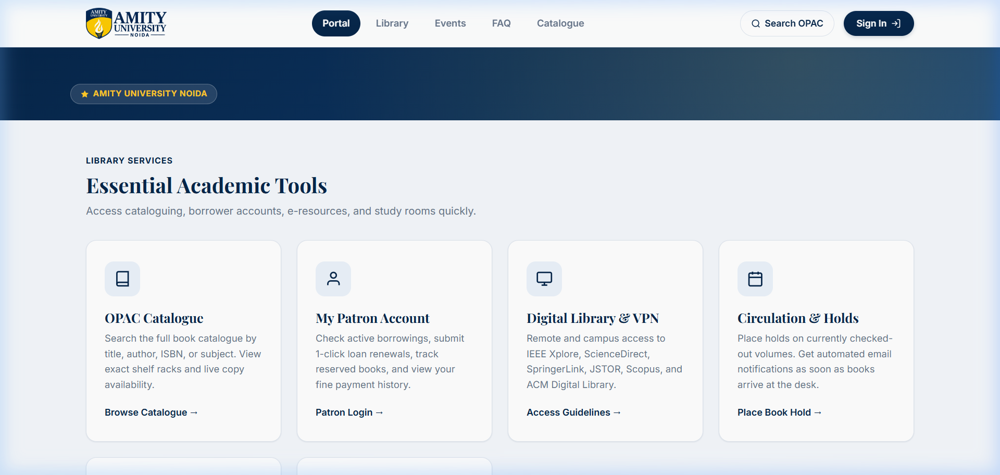
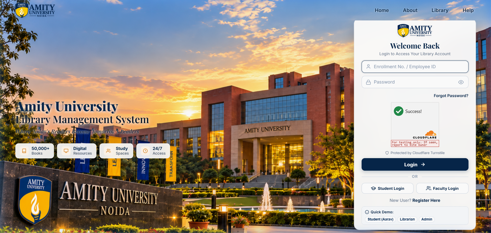
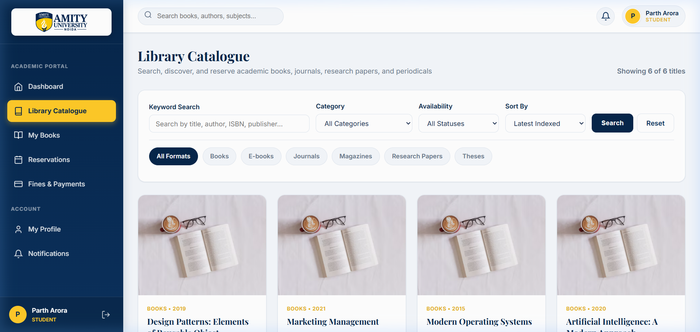
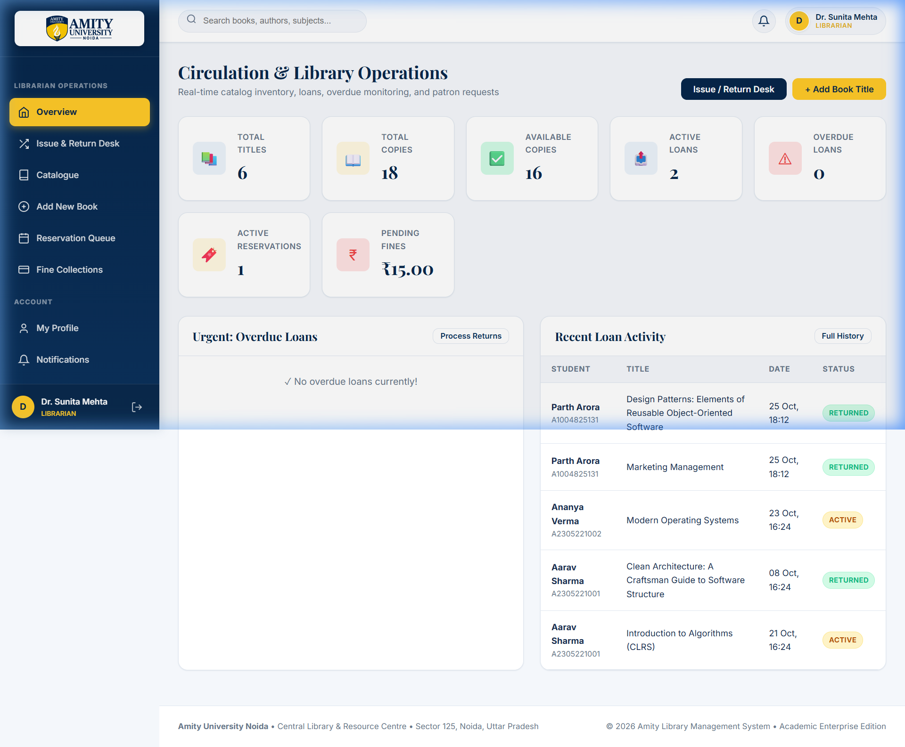
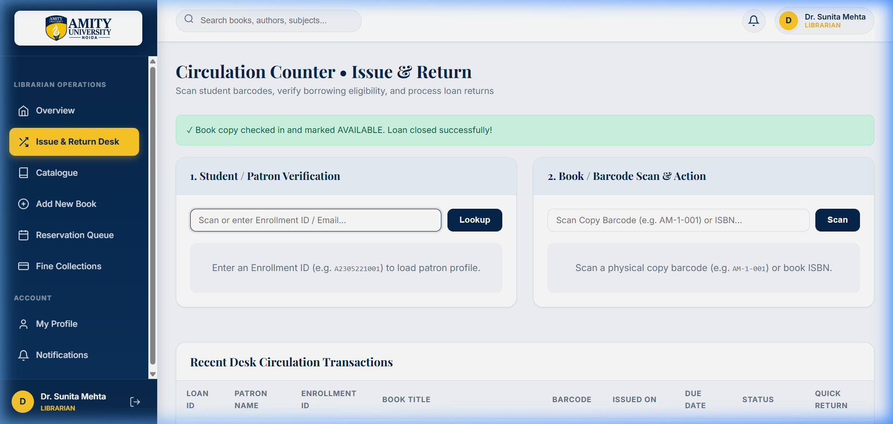
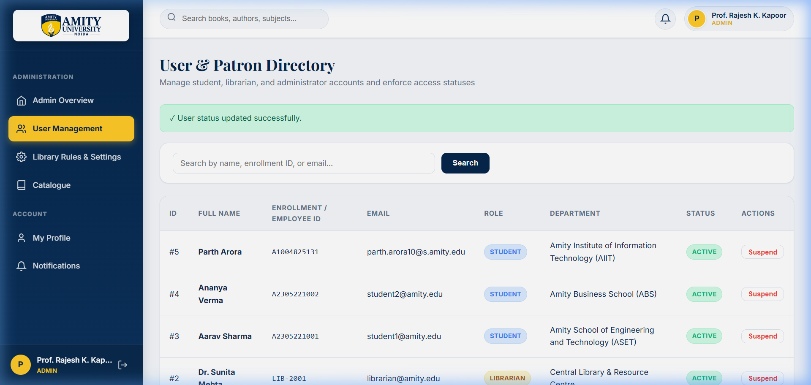
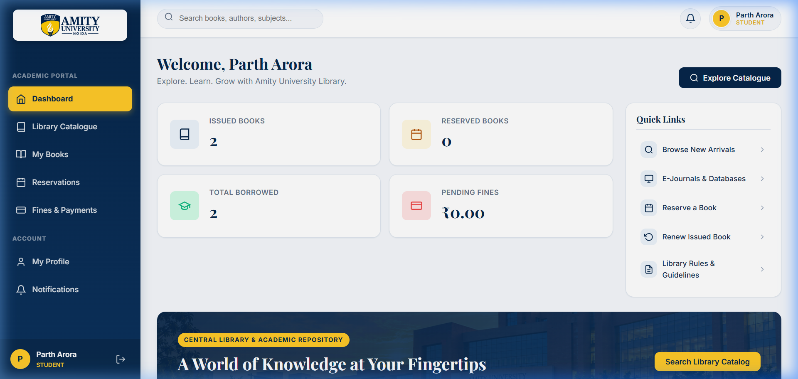
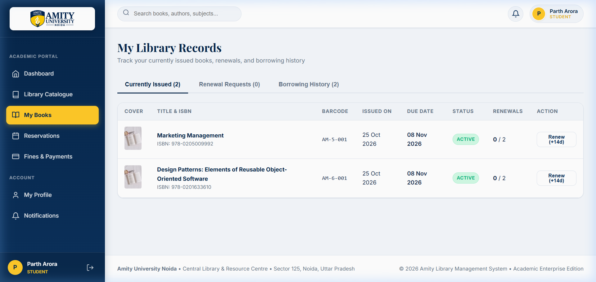

# 🎓 Amity University Noida - Library Management System (Academic Enterprise Edition)

An enterprise-grade, integrated, and secure **Library Management System** engineered specifically for **Amity University Noida**. Built following clean layered architecture using modern **Java 17+**, **Jakarta EE / Servlets & JSP**, **MySQL 8.0**, **HikariCP**, **BCrypt (Cost 12)** password hashing, and **Cloudflare Turnstile** bot challenge protection.

---

## 📸 Application Screenshots & Visual Showcase

### 1. Public Portal & Academic Discovery

*Public landing page offering OPAC quick search, digital library gateway, library operating hours, campus events, and FAQ knowledgebase.*

---

### 2. Secure Split-Screen Login & Cloudflare Turnstile

*Branded login interface featuring the Amity University Noida campus sunset backdrop, 1-click demo role fillers, and server-verified Cloudflare Turnstile bot defense.*

---

### 3. OPAC Library Catalogue & Smart Filters

*Full OPAC catalogue search supporting multi-field filtering by Title, Author, ISBN, Publisher, and Category formats with real-time copy availability badges.*

---

### 4. Librarian Operations & Circulation Dashboard

*Real-time library metrics: Total Titles, Copies, Active Loans, Overdue Loans, Active Reservations Queue, and Pending Late Fines.*

---

### 5. Circulation Counter (Barcode Scan & Return Desk)

*Circulation desk for rapid patron lookup, physical copy barcode scanning (e.g. `AM-1-001`), loan dispatch, and 1-click check-in with automated overdue fine calculation.*

---

### 6. User Governance & Role Management (Admin)

*Administrator interface to audit registered users, manage student/librarian accounts, and toggle user activation/suspension status.*

---

### 7. Student Academic Portal

*Personalized patron dashboard showing active borrowings, book holds, total borrowed history, fine balance, and quick access links.*

---

### 8. My Books Desk & 1-Click Renewals

*Self-service student portal displaying currently issued books with due date alerts, remaining renewals counter (max 2), and 1-click 14-day loan extension requests.*

---

## 🛠️ Tech Stack & Architecture

| Layer | Technology | Details |
| :--- | :--- | :--- |
| **Backend** | Java 17 / 21 | Core business logic, thread-safe service architecture |
| **Servlet API** | Jakarta EE / Servlets 6.0 & JSP | MVC controllers, session security, filter pipelines |
| **Server** | Apache Tomcat 9.0.x / 10.1.x | Enterprise servlet container (portable instance included) |
| **Database** | MySQL Server 8.0+ | Relational schema with 16 normalized tables and foreign keys |
| **Connection Pool**| HikariCP 5.1.0 | High-performance, low-latency JDBC connection pooling |
| **Password Security**| jBCrypt (Cost 12) | Irreversible salted hash authentication |
| **Bot Protection** | Cloudflare Turnstile | Server-verified bot challenge (fail-closed security) |
| **Build Tool** | Apache Maven 3.9+ | Dependency & lifecycle management (`mvnw.bat` included) |
| **Frontend** | HTML5, Modern CSS, Vanilla JS | Zero bulky framework dependencies, responsive university theme |

---

## 💻 Prerequisites (What to Install & Download)

Before running the application locally, ensure you have installed the following tools:

1. **Java Development Kit (JDK 17 or 21)**
   - Download: [Eclipse Temurin JDK 17/21](https://adoptium.net/) or [Oracle JDK](https://www.oracle.com/java/technologies/downloads/)
   - Verify in terminal:
     ```bash
     java -version
     ```
2. **MySQL Community Server 8.0 or higher**
   - Download: [MySQL Community Downloads](https://dev.mysql.com/downloads/mysql/) or install via [MySQL Installer for Windows](https://dev.mysql.com/downloads/installer/)
   - Verify MySQL service is running locally on port `3306`.
3. **Git**
   - Download: [Git for Windows](https://git-scm.com/download/win)
4. **Apache Maven (Optional)**
   - The repository includes a self-contained Windows Maven wrapper (`mvnw.bat`), so installing standalone Maven is optional.

---

## 🚀 Step-by-Step Local Setup & Execution Guide

### Step 1: Clone the Repository
Open PowerShell or your command prompt:
```bash
git clone https://github.com/parth181205/LIBRARY-MANAGEMENT-SYSTEM.git
cd LIBRARY-MANAGEMENT-SYSTEM
```

---

### Step 2: Database Setup & Population

1. Log into your local MySQL CLI or MySQL Workbench:
   ```bash
   mysql -u root -p
   ```
2. Run the database creation script:
   ```sql
   SOURCE database/schema.sql;
   ```
3. Populate the database with demonstration data (books, copies, patron accounts, loans, and settings):
   ```sql
   SOURCE database/seed.sql;
   ```
4. Verify the database:
   ```sql
   USE amity_library;
   SHOW TABLES;
   ```
   *(You should see 16 normalized tables including `users`, `books`, `book_copies`, `loans`, `reservations`, `fines`, and `audit_logs`).*

---

### Step 3: Configure Database Credentials

Open `src/main/resources/application.properties` and update your MySQL username and password:

```properties
# Database Connection Settings
db.url=jdbc:mysql://localhost:3306/amity_library?useSSL=false&allowPublicKeyRetrieval=true&serverTimezone=Asia/Kolkata&characterEncoding=UTF-8
db.username=root
db.password=YOUR_MYSQL_PASSWORD

# Cloudflare Turnstile Keys (Pre-configured with official testing keys that always pass)
turnstile.enabled=true
turnstile.siteKey=1x00000000000000000000AA
turnstile.secretKey=1x0000000000000000000000000000000AA
turnstile.verifyUrl=https://challenges.cloudflare.com/turnstile/v0/siteverify
turnstile.timeoutSeconds=5
```

---

### Step 4: Compile the Application

Run the Maven wrapper to compile Java classes and run automated unit tests:
```powershell
.\mvnw.bat clean package
```
This builds the deployable web archive: `target/amity-library.war`.

---

### Step 5: Run the Server Locally

#### Method A: 1-Click Launch (Recommended)
Use the included automated startup script:
```powershell
.\start-server.bat
```
*Or via PowerShell:*
```powershell
.\start-server.ps1
```
The server will boot up and be accessible immediately at:
👉 **`http://localhost:8080/amity-library/`**

#### Method B: Standalone Apache Tomcat Deployment
If you have your own Apache Tomcat installed (e.g. `C:\apache-tomcat-9.0.x` or `10.1.x`):
1. Copy `target/amity-library.war` to your Tomcat `webapps/` folder:
   ```powershell
   Copy-Item target\amity-library.war "C:\apache-tomcat\webapps\"
   ```
2. Start Tomcat:
   ```powershell
   & "C:\apache-tomcat\bin\startup.bat"
   ```
3. Open your browser:
   `http://localhost:8080/amity-library/`

---

## 🔑 Demonstration Accounts & Credentials

The login page includes **1-Click Demo Fillers** for instant evaluation:

| Portal Role | Official Email | Demo Password | Capabilities & Access |
| :--- | :--- | :--- | :--- |
| **Administrator** | `admin@amity.edu` | `admin123` | System rules, user activation/suspension, audit trail, global settings |
| **Librarian** | `librarian@amity.edu` | `lib123` | Counter circulation, barcode scanner, check-in, overdue fines & receipts |
| **Student** | `parth@amity.edu` | `user123` | Book search, hold reservations, 14-day loan renewals, fee receipts |
| **Student (Alt)** | `aarav.sharma@s.amity.edu` | `student123` | Student borrowing profile with active & overdue books |

---

## 📂 Project Directory Structure

```
LIBRARY-MANAGEMENT-SYSTEM/
│
├── pom.xml                                    # Maven configuration & dependencies
├── mvnw.bat                                   # Windows Maven wrapper
├── .gitignore                                 # Git exclusions (ignores build & server dirs)
├── start-server.bat                           # 1-Click startup script
├── start-server.ps1                           # PowerShell startup script
├── README.md                                  # Complete documentation & setup manual
│
├── database/
│   ├── schema.sql                             # DDL for 16 relational tables
│   └── seed.sql                               # Demo books, copies, users, loans, settings
│
├── screenshots/                               # Application interface screenshots
│   ├── 01_public_portal.png
│   ├── 02_login_screen.png
│   ├── 03_library_catalogue.png
│   ├── 04_librarian_dashboard.png
│   ├── 05_issue_return_desk.png
│   ├── 06_admin_users.png
│   ├── 07_student_dashboard.png
│   └── 08_student_my_books.png
│
├── src/main/java/com/amity/library/
│   ├── config/                                # DBUtil (HikariCP) & ConfigManager
│   ├── controller/                            # MVC Servlets (Login, Catalogue, IssueReturn, Dashboard)
│   ├── dao/                                   # Data Access Objects (UserDAO, BookDAO, LoanDAO, FineDAO)
│   ├── filter/                                # RBAC AuthFilter & OWASP SecurityHeadersFilter
│   ├── model/                                 # Domain POJOs (Book, BookCopy, Loan, User, Reservation)
│   ├── service/                               # AuthService, LibraryService, TurnstileService
│   └── util/                                  # PasswordUtil (BCrypt), CsrfUtil, RateLimiter
│
├── src/main/resources/
│   └── application.properties                 # Active DB & Turnstile settings
│
└── src/main/webapp/
    ├── assets/
    │   ├── css/                               # Institutional theme, glassmorphism, responsive grid
    │   ├── images/                            # Amity University crest, campus sunset imagery
    │   └── js/                                # Dynamic postAction, Turnstile callbacks
    └── WEB-INF/
        ├── web.xml                            # Session timeout & error routing
        └── views/                             # JSP templates (Student, Librarian, Admin, Public)
```

---

## ❓ Troubleshooting & FAQs

- **Port 8080 is already in use:**
  If port 8080 is occupied by another application, open `tomcat/conf/server.xml` and change the connector port:
  ```xml
  <Connector port="8081" protocol="HTTP/1.1" connectionTimeout="20000" redirectPort="8443" />
  ```
  Then access `http://localhost:8081/amity-library/`.

- **MySQL Access Denied / Connection Refused:**
  Ensure MySQL service is running (`Get-Service MySQL*`) and verify password in `src/main/resources/application.properties`.

- **Cloudflare Turnstile on Localhost:**
  The pre-configured site key and secret key in `application.properties` are official Cloudflare testing keys (`1x00000000000000000000AA`) designed to pass reliably on `localhost`.

---

## 📜 License & Accreditation

Engineered for academic operations at **Amity University Uttar Pradesh, Sector 125, Noida**.  
Licensed under the [MIT License](LICENSE).
